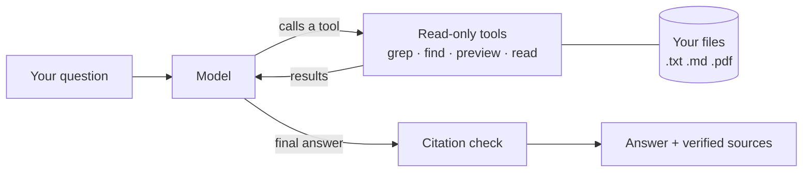

# FileFerret

Ask a question about the files on your PC. Get the answer with the exact file, page and line.

FileFerret hands a language model a few read-only tools and lets it search your files the way
Claude Code explores a codebase: search, read what it finds, refine, and repeat until it can
answer. There's no index to build and no embeddings. Every citation in the answer is checked
against the real file before it's shown.

It reads `.txt`, `.md` and `.pdf` files (PDFs with a text layer) and can find any file by name.

## How it works



The model decides every search; the code only runs the tools and checks the citations.
Details in [docs/architecture.md](docs/architecture.md).

## Quick start (free, with Gemini)

Needs Python 3.10+ and a free Gemini API key from [Google AI Studio](https://aistudio.google.com).
Commands below are for Windows PowerShell.

```powershell
git clone https://github.com/PaprBg/FileFerret.git
cd FileFerret
python -m venv venv
venv\Scripts\Activate
pip install -e ".[gemini]"
copy .env.example .env
```

In `.env`, set:

```
FILEFERRET_PROVIDER=gemini
GEMINI_API_KEY=your-key-here
```

Then ask:

```powershell
fileferret ask "what is my wifi password?" -v
```

The answer ends with a Sources list: each cited location (like `report.pdf:p3:L12`) and the
quoted line from the real file.

The free tier allows about 20 requests a day per model, and a question uses 3–7, so expect a
few questions a day. Snippets of the files it reads are sent to Google. Other providers,
including local models, are covered in [docs/models.md](docs/models.md).

## Everyday use

| Command | What it does |
|---|---|
| `fileferret ask "..."` | Ask a question. Searches your user folder by default. |
| `-v` | Show each tool call as it happens. |
| `--root PATH` | Search this folder instead; repeat for several. |
| `--provider NAME` / `--model NAME` | Pick the model, e.g. `--model gemini-3.5-flash`. |
| `--max-steps N` | Limit how many model calls one question may use (default 20). |
| `fileferret cache` / `cache --clear` | Show or delete the cache of extracted PDF text. |

If the model wants to look outside the allowed folders, it asks you first:
`Allow for this run? [y/N]`. See [docs/folders-and-privacy.md](docs/folders-and-privacy.md).

## Limitations

- **Answers depend on the model.** Small models often pick the wrong tool or give up early;
  `gemini-3.5-flash` handles questions that `gemini-3.5-flash-lite` fails.
- **"Verified" means the cited lines exist,** not that they support the answer. Read the quotes
  in the Sources list.
- **Scanned PDFs and drawings can't be read.** Only the PDF text layer is used.
- **Keyword search only.** A file that says "burnout" is found for "tired at work" only if the
  model thinks of that word.
- **Your files leave your PC with cloud models,** and the PDF cache keeps plain-text copies on
  disk ([docs/pdfs.md](docs/pdfs.md)).

## Roadmap

- Word, Excel and PowerPoint files
- Scanned PDFs and drawings: local OCR, plus on-demand vision for specific pages
- A chat mode that remembers the conversation
- Search by meaning as an extra tool

## Docs

- [Models and providers](docs/models.md): Claude, ChatGPT, Gemini, Ollama; keys, quotas, which models work well
- [Folders and privacy](docs/folders-and-privacy.md): what it may search, approval prompts, what is sent where
- [PDFs](docs/pdfs.md): page citations, scanned pages, the text cache
- [Architecture](docs/architecture.md): the loop, the tools, citation checking, adding tools or providers

## Development

```powershell
pip install -e ".[dev]"
pytest
```

Tests use a scripted fake model, so they need no API key and cost nothing.
